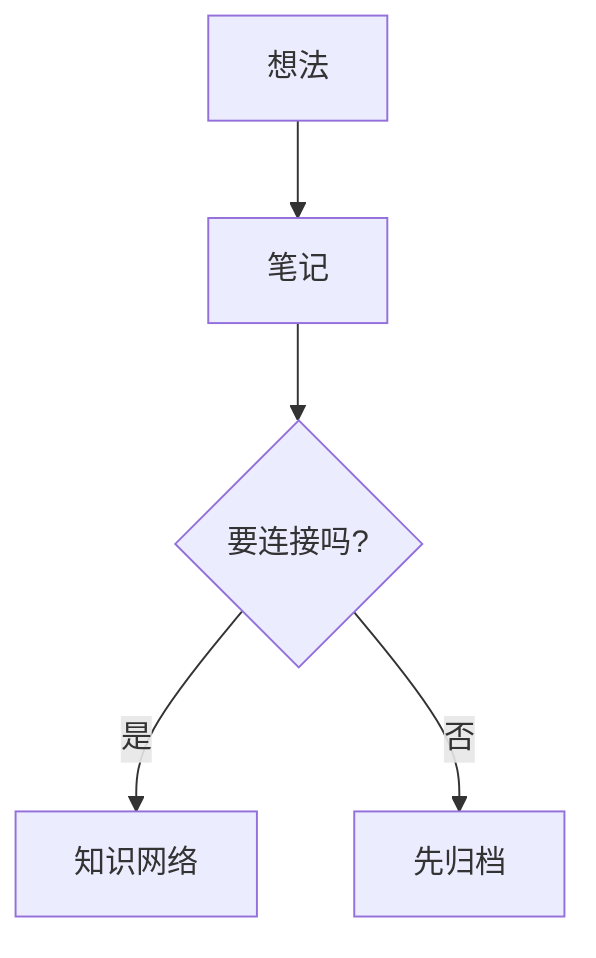

# Markdown 支持

> 这一篇既是语法清单，也是样式样板。行内模式下，右边这些写法应该直接呈现为最终效果。

## 文本

**粗体**、*斜体*、~~删除线~~、`行内代码`、[普通链接](https://example.com)。

也支持下划线写法：__粗体__、_斜体_、***粗斜体***；从其他编辑器粘贴过来的 Markdown 不需要改写法。

行内代码会使用品牌紫胶囊底色与等宽字体，不再只是把反引号显示出来。

图片写作 ``；行内模式会渲染成圆角卡片，点击图片可放大预览，`Esc` 或点击遮罩关闭。

快捷键写作：<kbd>⌘K</kbd> 打开命令面板，<kbd>⌘J</kbd> 让墨墨续写。也可以用 :sparkles: :fire: 这样的 emoji 短码。

[TOC]

Setext 也可以当标题
===

### 带自定义 ID 的小节 {#custom-id}

扩展行内语法：

- ==高亮文本==
- 上标：E = mc^2^
- 下标：H~2~O
- 脚注引用：知识花园[^garden]
- 裸链接：https://alma.now

[^garden]: 脚注定义会渲染成底部的小注卡片。

## 标题

### 这是 H3

#### 这是 H4

- H1 是章节开场，左侧站一只墨墨
- H2 是黄色分镜条
- H3 是品牌紫的小节标题
- H4~H6 逐级收敛

## 列表

- 无序列表
- 嵌套
  - 第二层
  - 第三层会更靠右

1. 有序列表
2. 第二项
3. 第三项

- [x] 已完成的任务
- [ ] 未完成的任务

无序列表会渲染成真正的圆点，不再保留 `-`；任务列表保留勾选框。在列表项末尾按 `Enter` 会自动续写下一个 `-` / `1.`，空项再按一次退出列表；支持 `-`、`*`、`+` 和 `1.`、`1)` 两种编号写法。

## 定义列表

术语
: 定义会缩进并带一条细线，适合名词解释。

另一个术语
: 第二条定义。

## 斜杠命令

在空行行首输入 `/` 会弹出块菜单，继续输入可筛选：

- `/h1` `/h2` `/h3`：标题
- `/ul` `/todo` `/ol`：无序列表、任务清单、有序列表
- `/quote` `/code` `/table` `/math` `/mermaid` `/hr`：引用、代码块、表格、公式、图解、分割线
- `/ai` `/summary`：让墨墨续写或总结
- `/daily`：打开今天的日记

用 `↑` `↓` 选择，`Enter` 确认，`Esc` 关闭。插入的是标准 Markdown，随时可以切到源码修改。

## AI 图解

行内模式支持 `figure` 代码块。它保存的是图规格 JSON，不是图片，所以可以直接改文字：

````md
```figure
{
  "kind": "flow",
  "title": "文件处理流程",
  "nodes": [{ "label": "选择文件" }, { "label": "格式探测" }],
  "takeaway": "先探测，再解析"
}
```
````

- `kind` 支持 `flow`（流程）和 `compare`（对比）。
- `⌘⇧G`、选区工具条“图解”、AI 菜单“生成图解”都会调用当前模型生成图规格。
- 生成后先预览，点“插入图解”才写入；插入后仍可在源码模式修改 JSON。
- 图内文字由本地渲染器排版，不交给图片模型画中文。

## 引用

> 引用会渲染成薄荷绿的对话气泡，首行带墨墨头像与「墨墨说」署名。

> 多行引用会连续成一张卡，不会一行一个气泡。
> 这是第二行。

## 提示卡

> [!tip] 提示
> tip 使用开心表情，适合技巧与建议。

> [!note] 备注
> note 使用思考表情，适合补充说明。

> [!warn] 警告
> warn 使用惊讶表情，适合风险与注意事项。

## 代码

行内代码：`const answer = 42`。

```ts
type Note = {
  id: string
  title: string
  tags: string[]
}

export function greet(name: string): string {
  // 语法高亮会区分关键字、字符串、注释与函数名
  return `hello, ${name}`
}
```

代码块顶部会显示语言栏（例如 `TS · CODE`），正文恢复语法高亮；不再把语言围栏和头像混在正文里。

## 表格

| 能力 | 状态 | 说明 |
|---|---|---|
| 行内渲染 | 已实现 | 标题、列表、引用、代码、表格 |
| 表格卡片 | 已实现 | 点击表格切到源码编辑 |
| Mermaid | 已实现 | 图解卡片，可点击编辑源码 |
| 数学公式 | 已实现 | 行内与块级 KaTeX |

表格会渲染成带表头与斑马纹的卡片；点一下表格可回到源码编辑。

## 数学

行内公式：$E = mc^2$。

块级公式（`$$` 单独成行，内部可多行）：

$$
\int_0^1 x^2 \, dx = \frac{1}{3}
$$

## Mermaid



图解会渲染成独立卡片，支持纸张与夜间主题；语法错误时会提示切到源码检查。

## 链接与双链

- 普通链接：[Alma](https://alma.now)
- 双链：[[项目介绍]]
- 标签：#markdown #guide

双链会渲染成品牌紫的胶囊，点击跳转；目标不存在时可以一键创建。

## 分割线

---

分割线会变成一条虚线，旁边是困倦的墨墨。

## Front Matter

```yaml
---
title: 文档标题
tags: [标签一, 标签二]
aliases: [别名]
created: "2026-11-23T00:00:00.000Z"
---
```

Front Matter 默认降噪显示，不抢正文；标题、标签、别名会被解析进文档元数据。

## 阅读模式块编辑

表格和 Mermaid 卡片在阅读模式可直接编辑：

- 点表格卡片 → 打开表格编辑器，可加行、加列、删除行列、设置每列对齐
- 点 Mermaid 卡片 → 打开源码 + 实时预览，保存后直接回写
- 点「保存」才会写回 Markdown；取消不产生修改
- 顶部仍保留「源码」模式，作为精细调整的兜底

## 源码模式

行内模式会隐藏语法标记，并把标记注册为原子区间，光标不会掉进 `#` 或 `**` 里面。行级间距使用 padding 参与 CodeMirror 的高度测量，因此标题、表格、代码块之后的点击位置与光标不会错位。

需要精细编辑语法时，点顶部「源码」或按 `⌘/` 切换；切换不会重置撤销历史、滚动位置或光标。表格与 Mermaid 卡片点击后也会切到源码。

## 支持矩阵

| 类别 | 语法 |
|---|---|
| 行内 | 粗体、斜体、删除线、高亮、行内代码、上下标、脚注引用、裸链接 |
| 标题 | H1~H6 |
| 块级 | 列表、任务列表、定义列表、引用、提示卡、代码块、表格、Mermaid、数学 |
| 连接 | 普通链接、双链、标签 |
| 元数据 | Front Matter、分割线、TOC、自定义标题 ID |
| HTML | `<kbd>` 键帽、emoji 短码 |

## 当前限制

- 脚注与定义列表目前是基础样式，复杂嵌套会降级为普通文本
- 暂不支持 MDX
